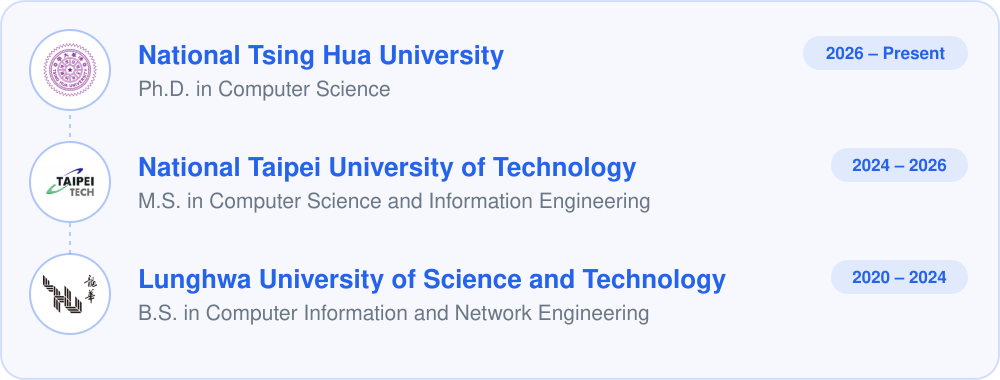

<a href="https://www.yucheng208.net"><picture><source media="(prefers-color-scheme: dark)" srcset="assets/badges/website-dark.svg"></picture></a>
<a href="https://www.yucheng208.net/files/yu_cheng_chang_cv.pdf"><picture><source media="(prefers-color-scheme: dark)" srcset="assets/badges/cv-dark.svg"></picture></a>
<a href="https://scholar.google.com/citations?user=-SWWt7kAAAAJ"><picture><source media="(prefers-color-scheme: dark)" srcset="assets/badges/scholar-dark.svg"></picture></a>
<a href="https://orcid.org/0000-0003-1301-9192"><picture><source media="(prefers-color-scheme: dark)" srcset="assets/badges/orcid-dark.svg"></picture></a>
<a href="https://www.linkedin.com/in/yucheng208/"><picture><source media="(prefers-color-scheme: dark)" srcset="assets/badges/linkedin-dark.svg"></picture></a>

<b>English</b> · <a href="https://github.com/Yucheng0208/Yucheng0208/blob/main/README.zh-TW.md">繁體中文</a> · <a href="https://github.com/Yucheng0208/Yucheng0208/blob/main/README.ja.md">日本語</a>

<picture><source media="(prefers-color-scheme: dark)" srcset="assets/headings/about-dark.svg"></picture>

My research centers on multimodal AI and computer vision, including human pose estimation and sign language recognition, and increasingly on large language models (LLMs): improving the security and trustworthiness of LLM-based systems and applying LLMs to cybersecurity. Alongside research, I teach at the university and secondary-school levels and work to connect academic research with real-world practice. I also lead [ICI Lab](https://www.yucheng208.net/ici-lab).

<picture><source media="(prefers-color-scheme: dark)" srcset="assets/headings/research-dark.svg"></picture>

**A Contract-Grounded Runtime Validation Framework for LLM-Assisted Network Management** 
IEEE ICC 2027 · Submitted 
Checks LLM-proposed network management actions against explicit contracts at runtime, making LLM-based systems safer and more trustworthy.

**AK-SLR: Attention-Guided Keypoint-Based Multimodal Sign Language Recognition** 
IEEE ICIP Workshops 2026 
Attention-guided, keypoint-based multimodal recognition of sign language.

**MultiPose: Unified Full-Body Multimodal Fusion via xLSTM-Based Lightweight Temporal Modeling** 
IEEE VCIP 2026<!-- status:vcip2026 --> · To appear · Dec 13–16, Singapore<!-- /status --> 
Unified full-body multimodal fusion with lightweight xLSTM-based temporal modeling.

<a href="https://www.yucheng208.net/publications">Full publication list →</a>

<picture><source media="(prefers-color-scheme: dark)" srcset="assets/headings/education-dark.svg"></picture>

<picture><source media="(prefers-color-scheme: dark)" srcset="assets/education/education-dark.svg"></picture>

<picture><source media="(prefers-color-scheme: dark)" srcset="assets/headings/highlights-dark.svg"></picture>

<a href="https://www.yucheng208.net/publications"><picture><source media="(prefers-color-scheme: dark)" srcset="assets/chips/publications-dark.svg"></picture></a> 
38+ works including conference papers, journal articles, patents, and a book

<a href="https://www.yucheng208.net/publications">Full publication list →</a>

<a href="https://www.yucheng208.net/honors"><picture><source media="(prefers-color-scheme: dark)" srcset="assets/chips/honors-dark.svg"></picture></a> 
64+ awards, including 20+ gold medals at international invention exhibitions

- **Best Conference Paper Award** — IEEE ICCBE 2025
- **Best Student Paper Honorable Mention** — 20th Workshop on Wireless, Ad-Hoc and Sensor Networks (WASN 2025)
- **Titanium Prize (Top 10%)** — Green Idea Invention and Design Fair 2025
- **Outstanding Science and Technology Innovation Award** — ISPARK International Pitching Competition 2024
- **Gold Medal** — Japan Design, Idea & Invention Expo 2025

<a href="https://www.yucheng208.net/honors">All honors and awards →</a>

<a href="https://www.yucheng208.net/projects"><picture><source media="(prefers-color-scheme: dark)" srcset="assets/chips/projects-dark.svg"></picture></a> 
NSTC-funded and industry research projects

<a href="https://www.yucheng208.net/projects">All research projects →</a>

<a href="https://www.yucheng208.net/teaching"><picture><source media="(prefers-color-scheme: dark)" srcset="assets/chips/teaching-dark.svg"></picture></a> 
University and secondary school courses in AI, programming, and digital logic

<a href="https://www.yucheng208.net/teaching">Full teaching record →</a>

<a href="https://www.yucheng208.net/highlights"><picture><source media="(prefers-color-scheme: dark)" srcset="assets/chips/talks-dark.svg"></picture></a> 
Invited talks, workshops, and media coverage

<a href="https://www.yucheng208.net/highlights">All talks and media →</a>

---

<a href="https://blog.yucheng208.net/">Blog</a> ·
<a href="https://www.yucheng208.net/ici-lab">ICI Lab</a> ·
<a href="https://www.researchgate.net/profile/Yu-Cheng-Chang-14">ResearchGate</a> ·
<a href="https://hackmd.io/@Yucheng208">HackMD</a> ·
<a href="https://linktr.ee/ryan.02.08">Linktree</a>

